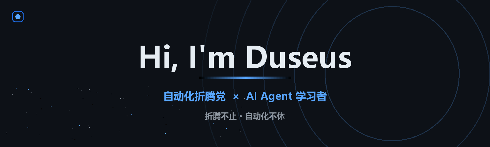

  

**📚 永远的学习者 | 🤖 AI Agent 爱好者 | 🔥 三分钟热度拥有者**

*I turn repetitive work into scripts, and scripts into systems.*

   

---

## 🧭 关于我

- 📚 **学习中**：Python / Linux / AI Agent，边学边做，边做边记
- 🌱 正在探索 **AI Agent 工作流**：多 Agent 协作、提示词工程、MCP
- 🤖 折腾开源的 [Hermes Agent](https://github.com/NousResearch/hermes-agent)，体验个人 AI Agent 的能力边界
- 🐧 喜欢鼓捣一切有趣的事情
- ⚡ 信条：**保持好奇，持续折腾**

## 🧰 技术栈

## 🚀 学习方向

| 方向 | 在学什么 |
| --- | --- |
| 🤖 **AI Agent** | 多 Agent 协作（Claude Code / Hermes Agent）、MCP、工具链编排 |
| 🔧 **自动化脚本** | 爬虫、定时任务、运维工具、效率小工具 |
| 📊 **数据分析** | 数据清洗、可视化、报表自动化 |
| 📖 **博客 & 写作** | Hexo 建站、主题魔改、记录学习日常 |

## 🛠️ 原创项目

| 项目 | 在做什么 |
| --- | --- |
| [**hermes-lark-cards**](https://github.com/Duseus/hermes-lark-cards) | 给 Hermes Agent Gateway 做飞书 CardKit 实时流式卡片 |
| [**claw-lark-cards**](https://github.com/Duseus/claw-lark-cards) | OpenClaw 的飞书通道插件：工具步骤、指标栏与流式卡片 |
| [**opensquilla-lark-streaming**](https://github.com/Duseus/opensquilla-lark-streaming) | OpenSquilla 的轮次面板、token 与上下文指标 |
| [**团团**](https://github.com/Duseus/tuantuan-ip) | 角色、贴纸、头像、壁纸与动画 |

## 📊 GitHub 统计

<table><tr><td>

</td><td>

</td></tr></table>

<picture>
  <source media="(prefers-color-scheme: dark)" srcset="https://raw.githubusercontent.com/Duseus/Duseus/output/snake-dark.svg" />
  <source media="(prefers-color-scheme: light)" srcset="https://raw.githubusercontent.com/Duseus/Duseus/output/snake-light.svg" />
  
</picture>

<h3 align="center">🌱 还在学习的路上，欢迎交流指正 ⭐</h3>
